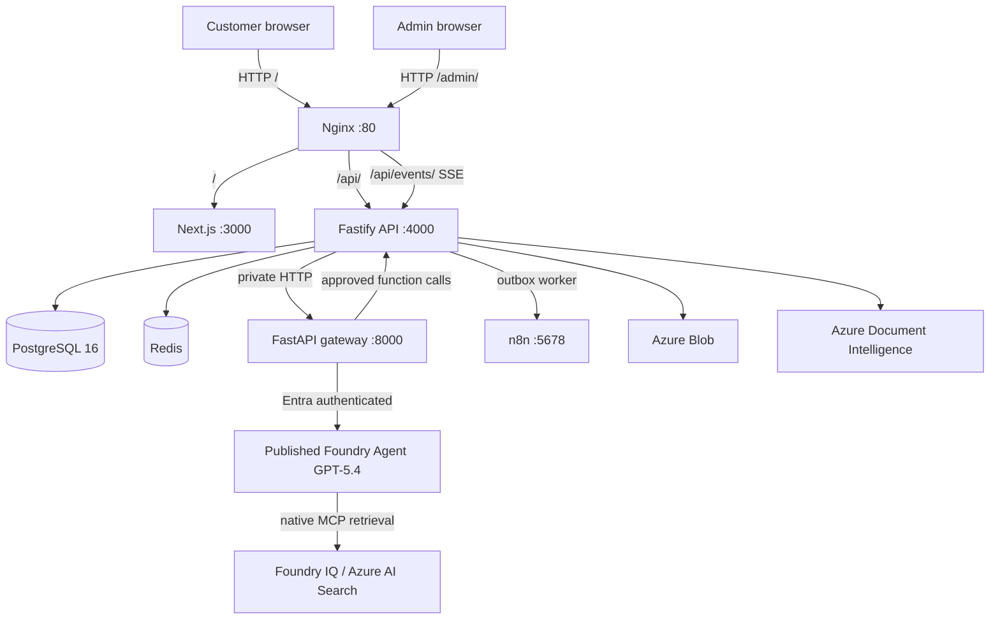

# Architecture and component ownership

## Runtime topology

Angular is built to static `/admin/` assets inside the Nginx image; it is not a long-running container. The operation dispatcher may initially run in the Node process with bounded leases or as a separate worker only when reliability needs justify the service.

## Ownership boundaries

| Component | Authority | Must not do |
|---|---|---|
| Next.js | Customer presentation, API/SSE client | Hold internal service keys; directly call Foundry/n8n |
| Angular | Admin presentation | Bypass API authorization; access Azure secrets |
| Nginx | Single public ingress and Angular static files | Host business policy |
| Node Fastify | Authoritative agent resolution, identity, tickets, catalog, consent, operations, event outbox | Trust model assertions as finalized actions |
| Python FastAPI | Versioned Foundry invocation, function-call relay, Presidio, budgets/errors | Own customer identity, create leads directly, store authoritative tickets |
| Foundry Agent | Model reasoning and tool selection | Authorize external side effects, invent source evidence |
| Foundry IQ | Authorized, attached business knowledge retrieval | Store customer ticket attachments |
| PostgreSQL | Durable transactions, facts, action/event history | Embedding vector storage in POC |
| Redis | Ephemeral context/OTP, coordination, fanout | Sole source of durable messages or business outcomes |
| n8n | Approved workflow adapters | Self-authorize actions from prompts |

## Agent as root

`agents` maps a public alias and UUID to active, immutable versions of Foundry agent, persona, knowledge binding, intent catalog, offerings catalog and workflow permissions. The app maintains a stable `agent_id` independent of Azure IDs. Each ticket pins the relevant versions to prevent mid-transaction drift.

Do not add a Tenant entity. That does **not** remove the requirement for RBAC, row/record-level isolation or per-agent tool and knowledge access.

## Conversation transaction

1. Browser posts to Node over same-origin `/api/`. Browser never calls Python or Foundry directly.
2. Node validates agent, ticket ownership, size limits and request ID; inserts accepted customer message and event in PostgreSQL.
3. Node loads version-pinned agent binding and authorized conversation context.
4. Node calls Python with trusted metadata and message. Python uses `AzureCliCredential` in local POC.
5. Foundry answers directly or retrieves Foundry IQ. Application function requests go through the Python dispatcher to the scoped Node tool registry; outputs return to Foundry.
6. Node validates reply/evidence contract and commits assistant message/events; SSE pushes status with durable IDs and supports replay.
7. Errors produce explicit failure state and a retry path; a failed model run never pretends an operation succeeded.

## Transport

- Browser writes: authenticated HTTP `POST`; server-to-browser updates: SSE.
- Node-Python: private HTTP with service authentication/authorization and request correlation; network privacy alone is not authorization.
- Node-worker-n8n: private network; idempotent operations and signed/verified callbacks or reconciliation.
- Browser/Admin same origin: `/api/`; no public `/ai-gateway/`, database or n8n route.

## Failure handling

- Foundry timeout: persist pending/failed response event; allow safe retry with dedupe.
- Redis outage: load context/events from PostgreSQL; do not lose authoritative state.
- n8n callback failure: preserve unknown/retryable states until trusted reconciliation.
- Knowledge retrieval failure: explain lack of verified answer; do not fill business gaps from general model memory.
- Network restarts: SSE reconnects with replay cursor from durable `ticket_events`.

The default first milestone is one verified live chat path, not the full administration platform.
