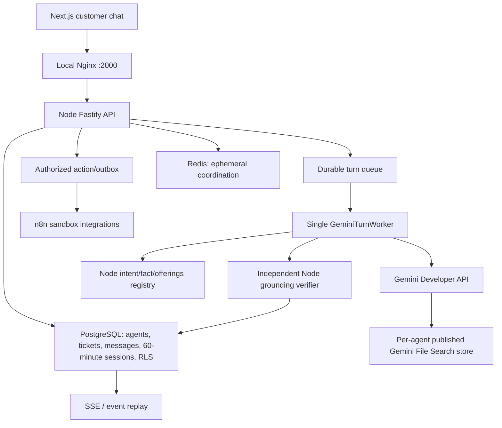

# Gemini experiment — system architecture

## Component flow

No Python model gateway, LangGraph, pgvector, custom embedding pipeline, tenant domain or second model orchestration path. The sample agent Sara is an instance of generic, agent-scoped configuration.

## Ownership

| Area | Owner | Safety requirement |
| --- | --- | --- |
| Model response generation | Gemini API, invoked by Node | Model receives only published persona/model/tools and scoped context |
| Knowledge index | Gemini File Search | Only approved agent store/version; no web search |
| Factual response acceptance | Node grounding verifier | Verify claims against exact authorized documents and approved catalog revisions before persistence or SSE |
| Identity and tickets | Fastify + PostgreSQL | Agent-scoped tickets and guest/customer ownership |
| Conversation state | PostgreSQL Gemini session | 60 minutes of inactivity from last accepted customer message; no AI context carryover |
| Intent, requirements and offerings | Node PostgreSQL catalogs | Published, pinned versions; no model-authored prices |
| Business tool execution | Node allowlisted tool registry | Trusted server scope, bounded call loop, typed results |
| External actions | Node authorization + outbox + n8n | Explicit customer consent, idempotency and verified provider outcome |
| Event transport | PostgreSQL durable events + SSE / Redis | DB replay if Redis fanout is lost |
| Approved knowledge originals | Private operator-controlled storage | Immutable digest/approval/provenance and scoped downloads |

The model may ask follow-up questions naturally and request published read/recording tools. It cannot grant itself permissions, trigger arbitrary operations, select a different knowledge store or assert that a provider completed an action.

## Response and session integrity

An incoming message is accepted durably before model invocation. The worker handles function continuation and optional knowledge retrieval in bounded passes, then runs independent evidence checks. Unsupported material claims cannot be published; safe clarifications may be returned without citations.

Session scope and pinned agent/catalog/knowledge version are server-derived. PostgreSQL holds durable accepted messages, model evidence/audit, pending encrypted function state, and expiry. Redis is not the authority. Ticket history persists after AI session expiry, but must not be silently copied into a new AI context.

## Deployment boundary

The experiment uses an independent Compose project `ai-service-agent-gemini`, dedicated volumes and networks, and only `127.0.0.1:2000:80` as the published port. Optional n8n runs inside the backend network. Public deployment needs TLS and independent security review.

## Release evidence

See [P7 status](gemini-p7-status.md), [Gemini conversation runtime](03-gemini-and-conversation.md), [data model](04-data-model.md) and [testing gates](09-testing-and-acceptance.md). Offline test passes do not establish live Gemini retrieval attribution, real n8n UAT or full security certification.
