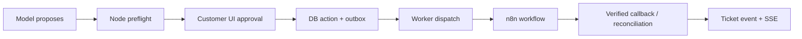

# Tools, intents, operations and n8n workflows

## Separation of responsibilities

**Foundry** decides what to say and which *registered* functions to request. The function registry and handlers are implemented **inside Node**, and the Foundry agent receives only descriptions. **Node** determines whether a function is allowed, whether the requested data is visible and whether an operation can occur. **n8n** executes only authorized external workflow requests.

This POC uses **native Foundry IQ MCP** for business knowledge retrieval. It is configured on the agent, and is not duplicated as an application function. Application functions are separately defined by the platform.

## Read tools (first phase)

| Function | Node-owned response |
|---|---|
| `find_intents` | Relevant published business goals matching the conversational request |
| `get_intent_requirements` | Required, verified, missing and conditional requirements for an intent | 
| `record_ticket_facts` | Save explicit current-message customer answers or corrections in Node/PostgreSQL with message provenance; customer-stated is not independently verified |
| `get_offerings` | Current eligible services/packages and published prices with validity |
| `get_ticket_context` | Authorized ticket facts, summary and status |
| `get_document_data` | Selected verified and flagged OCR-extracted fields, never raw unrelated uploads |

Agent-specific tools are **allowlisted** by published agent configuration. Tool contracts must include input schema, output schema, authorization rule, max payload and errors. Node derives agent/ticket/account scope from trusted context, **not tool arguments**. Read tools must not mutate business state. `record_ticket_facts` is a **separate scoped context-write tool**, not a workflow or external side effect. Node validates the source customer message and allowed requirement keys.

## Action tools

| Function | Contract |
|---|---|
| `preflight_operation` | Read-only eligibility check with unmet prerequisites and permissions |
| `propose_operation` | Creates a non-executing proposal; captures intent/requirements and clear customer-facing summary |
| `get_operation_status` | Returns only authoritative, correlated execution status and verified provider references |

**No n8n trigger or direct CRM mutation is model-visible.** Actual execution occurs by **separate secure HTTP confirmation from the customer UI**. The model must not be able to authorize its own proposal. The service records the proposal fingerprint, effective scope and required consent. A proposal is not an execution result.

## Intent and offerings catalogs

An intent is a goal (e.g. `company_formation`), not a keyword-only classifier or a fixed scripted dialogue. Its versioned definition can contain description, language variants, examples, required fields, eligible actions and linked offerings. The model semantically matches the goal and uses read tools to collect missing requirements conversationally.

Products/services/packages and price revisions are separate versioned data. One offering may support multiple intents. Business knowledge from IQ is explanatory; formal quotations use approved structured data and documented conditions.

## Operation lifecycle

Canonical states: `proposed`, `authorized`, `queued`, `running`, `verified_completed`, `retryable_failed`, `terminal_failed`, `unknown_outcome`, `rejected`. Never collapse `queued` or HTTP 200 into `verified_completed`.

## Execution invariants

1. Node checks published agent permission, authenticated ticket ownership, current offering/intent revision and every action-specific prerequisite.
2. Customer consent must identify the operation and material consequences; store time, scope and fingerprint. Sensitive actions cannot be approved just by model language.
3. Node commits the authorization and outbox event transactionally; use stable idempotency key on retries.
4. A worker (initially a module in Node if appropriate) leases the outbox row and makes a **private authenticated** n8n invocation.
5. n8n has per-agent workflow bindings and provider credentials not exposed to model/browser. Never accept an arbitrary customer-provided n8n URL.
6. Callback uses signed/authenticated evidence and execution correlation; reject replay/unknown provider reference. Reconcile uncertain outcomes rather than rerunning blindly.
7. Node writes verified status and related ticket event; SSE clients receive the update, with database replay if needed.

## Example template operations

- `create_lead`: validate customer opt-in and required contact/business details; dedupe/reconcile CRM provider record, store verified lead ID.
- `generate_quote`: validate selected offering price revision, eligibility and required inputs; generate/document official quote via an authorized workflow, store verified quote reference and document.
- `send_quote`: separate customer authorization and validated destination; record transport/provider evidence.

These are templates, not hardcoded ANCFZ lifecycle stages. Other agents register different intents, catalogs and operations without changing core services.

## Error budgets and observability

Bound tool calls per turn, recursion, timeout and payload size. Record call IDs, latency, tool name, authorized agent ID, result status and error classification. Avoid sending customer PII to logging. Tests must cover malformed schemas, absent tools, access denial, replay, concurrent approval, n8n timeout, callback forgery, evidence mismatch and duplicate provider outcomes.

Do not expose the n8n editor publicly through Nginx. Internal callbacks never make Nginx an authorization boundary.
