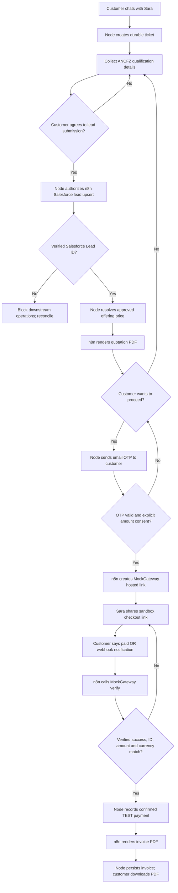

# ANCFZ P4 — Approved customer workflows

Status: ANCFZ-specific integration contract; **not** live-certified. This does not change the generic core's agent isolation model.

## Scope and authority

The four ANCFZ external business workflows are:

1. `ancfz_salesforce_lead`: create/upsert a Salesforce **Lead** using approved customer details.
2. `ancfz_render_pdf`: render either an ANCFZ **quotation** or **invoice** with Gotenberg.
3. `ancfz_payment_link`: create a **demo Orders** request against the ANCFZ-specific MockGateway API after explicit customer agreement and **Node-verified email OTP**; return a checkout link only if present in the actual response.
4. `ancfz_payment_verify`: **not configured yet** for this demo Orders API. It must independently verify the provider transaction when a documented status endpoint is available. Only a real matched success authorizes `ancfz_render_pdf` with `documentType=invoice`.

**Ticket creation is a direct Node/PostgreSQL operation only.** No n8n workflow or Foundry function may create tickets.

Foundry Sara may conversationally discover an intent, collect customer-stated details and explain options. The model never owns the operation state, grants permission, mints an OTP, executes n8n directly or declares money received.

Node owns all ticket/action state, customer scope, consent, idempotency, signed workflow dispatch, OTP challenges, provider correlation and authoritative completion statuses. n8n owns Salesforce/MockGateway HTTP calls and PDF rendering as an unprivileged integration worker.

All workflow bindings are **ANCFZ-only** (`agent_key=ancfz`) and must not become globally available model tools. Keep ANCFZ workflow data under `infra/n8n/ancfz/`.

## Correct order



## API/operation contracts (planned)

Node public endpoints must use the existing session cookie, server-resolved ticket agent ID and `authorizedTicket`. Cross-site POSTs are denied; requests use independently generated UUID idempotency keys and strict schemas.

| Node operation | Required condition | n8n binding | Success evidence |
|---|---|---|---|
| Create ticket | Verified guest/customer session | **none** | PostgreSQL ticket ID |
| Authorize lead | Explicit contact-data sharing consent and required contact fields | `ancfz_salesforce_lead` | Salesforce record ID confirmed by provider |
| Request quotation | Lead success + published offering with price revision | `ancfz_render_pdf` with `quotation` | Stored PDF/document ID and checksum |
| Start payment OTP | Customer requests payment and accepts exact quotation amount | email delivery binding, **not** model tool | Challenge sent; no OTP in chat/logs |
| Authorize payment | Unexpired, unused email OTP + consent tied to exact quote revision/amount | `ancfz_payment_link` | Unique MockGateway payment ID and HTTPS checkout URL |
| Verify payment | Existing unique payment ID; customer reports paid or trusted callback | `ancfz_payment_verify` | Fresh gateway-side verify response matching amount/currency |
| Issue invoice | Verified test payment for matching quotation | `ancfz_render_pdf` with `invoice` | Stored invoice PDF/document ID and SHA-256 |

A quote is not an invoice. Do **not** generate an invoice before payment verification.

Suggested operation state: `proposed → authorized → queued → running → verified_completed`, with `rejected`, `failed` and `unknown_outcome` terminal/hold states. Keep `unknown_outcome` non-retryable until independently reconciled to avoid duplicate Leads/payment links/invoices. Persist every correlated provider ID and request ID before accepting a downstream step.

## Salesforce lead

Required ANCFZ fields should include `LastName`, `Company`, a usable customer contact, business enquiry and optional package/visa needs. Restrict data sent to approved fields. For robust deduplication, provision a Salesforce **unique external ID** field for the Node ticket UUID (e.g. `ANCFZ_Ticket_ID__c`) and use REST upsert with the connected Salesforce OAuth credential; do not call naive `POST Lead` repeatedly. Never trust a model-generated Salesforce ID.

## Quotation and invoice PDF

Use n8n + an internal-only **Gotenberg** PDF conversion container. Generate HTML from server-authoritative fields and HTML-escape customer-provided text. Supply ANCFZ brand, document number, currency, line items, taxes/terms/total, issue date and versioned price revision. The n8n workflow returns a PDF binary plus metadata to Node; Node validates MIME/size and stores the file privately with a digest and ticket-scoped access. Never share a public Gotenberg or n8n URL.

Only use real, configured tax figures. The seed catalog has no validated ANCFZ package pricing, so quotation/payment must **fail closed** until prices are published.

## Customer consent and OTP

Node generates a cryptographically random six-digit OTP, stores **only** a keyed digest, associates it with ticket, verified contact email, quotation fingerprint and approved amount, and expires it after 5 minutes. Limit failed attempts, throttle resends, invalidate prior challenges and forbid reuse. OTP submission occurs in a **separate authenticated HTTPS UI form**, not in conversation or a Foundry prompt. Use a configured email delivery provider; when mail cannot be sent, reject the authorization rather than returning the OTP.

The payment operation requires both OTP verification and a separate affirmative acceptance of the precise amount/currency and quotation. On local HTTP, use only non-sensitive disposable test identities; real OTP/contact information needs TLS.

## MockGateway sandbox

Use the ANCFZ-specific endpoint supplied for this project:

```text
POST https://mockgateway.com/api/v1/public/demo/base/ancfz-f6i0ry/rest/6.0/orders/
X-API-Key: <private n8n HTTP Header Auth credential>
X-Guest-ID: <configured demo guest UUID>
Content-Type: application/json

{
  "Currency": "AED",
  "Items": [{"Price": {"UnitNetPrice": "<approved decimal price>"}}],
  "ExternalReference": "<stable Node-generated ANCFZ reference>",
  "BillingDetails": {
    "FirstName": "<authorized customer name>",
    "Email": "<authorized email>",
    "CountryCode": "<ISO-3166 alpha-2>"
  },
  "PaymentDetails": {"Type": "CC"}
}
```

Keep the user-supplied key out of Git and logs. `X-Guest-ID` is provider metadata, **not customer authentication**. The actual response contract, any hosted checkout URL and the documented order-status retrieval endpoint still require a live sandbox trace. The generic `/api/pg/{slug}/init` and `/api/pg/{slug}/verify` paths are a **different** MockGateway integration and must not be used here. The fail-closed verifier always returns `verified:false` until updated and tested against this same Orders API.

After the customer says **"I've paid"**, do not set `paid=true` on customer statement or redirect query parameters. Ask n8n to perform an independent server-to-server **verify** with the stored gateway payment ID. Compare confirmed success code, ID, amount and currency against the authorized quotation. A trusted webhook should trigger the same verification, not bypass it.

MockGateway is a **test-only payment simulator**. Display **"Test payment confirmed"** in this POC. It cannot establish that real funds have been received; a real gateway is required before production invoices are considered proof of paid orders.

## Integration security and deployment

- n8n private on Docker backend; only Nginx host port 80 published for isolated development.
- Node invokes only allowlisted, fixed webhook paths over Docker DNS and requires webhook Header Auth credentials; the browser/model cannot supply arbitrary n8n URLs.
- n8n credentials hold Salesforce OAuth, MockGateway API key and SMTP/email configuration; no secrets in exported workflow JSON, Git or logged payloads.
- Disallow unverified n8n callbacks from directly writing DB state. Node must enforce input validation, correlation and evidence matching before advancing.
- Use per-operation idempotency keys and immutable snapshots of approved quote/pricing.
- Failure/timeout remains `unknown_outcome` until reconciliation. Never mark HTTP 200 or a generated PDF as proof a Salesforce lead or payment succeeded.
- For future public deployments use HTTPS, CSRF protection, signed callback / restricted network access, audit logging, private documents and robust PII policy.

## Acceptance scenarios

1. Node creates a ticket; Salesforce and n8n are not invoked on ticket creation.
2. Consent denied: no Salesforce lead or contact-data transfer.
3. Consent accepted twice: exactly one Salesforce Lead per ticket.
4. Invalid/expired/reused OTP: no payment link is issued.
5. Valid OTP but price changed: authorization rejected; request new agreement.
6. MockGateway link generated once; message includes exact quote and **test** label.
7. Customer says "paid" while gateway says pending/failed: **no invoice** and no paid claim.
8. Verified success with mismatched payment ID/amount/currency: **no invoice**.
9. Verified matched success: one stored invoice and ticket event; reconnecting SSE recovers it.
10. Out-of-order/duplicate webhook, network timeout, declined checkout and restart produce no duplicate side effects.
11. Cross-ticket/other-agent reads/actions are denied via Node owner checks and PostgreSQL RLS.
12. Real Azure Foundry IQ, Salesforce OAuth, MockGateway live sandbox and actual n8n imports are independently smoke-verified before declaring P4 complete.

## Required live configuration before enabling operations

- Salesforce connected app/OAuth and unique external lead-ID field.
- ANCFZ-specific approved offerings and current prices, including applicable tax rules.
- n8n imported active workflows and credentials; internal Gotenberg.
- A MockGateway **account-created** gateway slug, API key, sample init and verify payloads.
- Secure email delivery and OTP UI.
- Signed dispatch/callback configuration and private document storage.
- Live test evidence for success/failure/timeout scenarios.

Documentation is not a production implementation and is not live validation.
